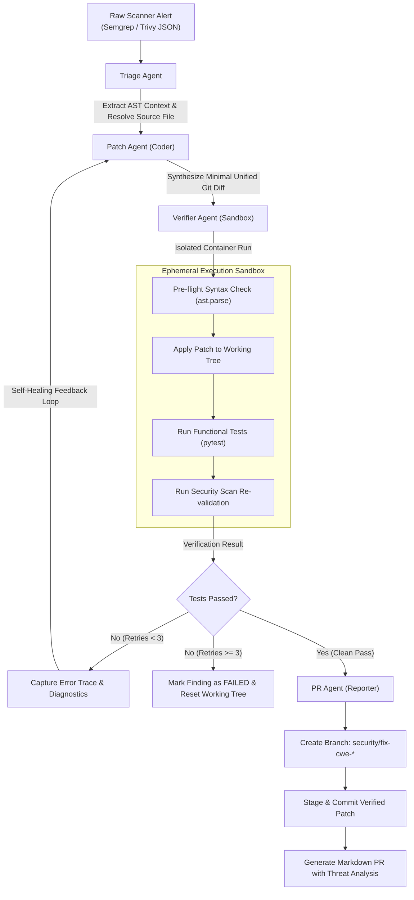

# Autonomous Agentic Patching & DevSecOps Remediation Bot

[](https://github.com/ravishkarathnayaka/Autonomous-Agentic-Patching-DevSecOps-Remediation-Bot/actions/workflows/ci.yml)
[](https://github.com/ravishkarathnayaka/Autonomous-Agentic-Patching-DevSecOps-Remediation-Bot/actions/workflows/security-scan.yml)
[](https://www.python.org/downloads/)
[](https://opensource.org/licenses/MIT)
[](https://ollama.ai)

> **Autonomous multi-agent DevSecOps bot that ingests SAST/SCA alerts, generates surgical security patches, validates regressions in ephemeral Docker sandboxes, and submits production-ready annotated Pull Requests.**

---

## 📌 Table of Contents
- [Live Web Portal & Vercel Deployment](#-live-web-portal--vercel-deployment)
- [Executive Overview](#-executive-overview)
- [Multi-Agent State Architecture](#-multi-agent-state-architecture)
- [Supported 60-Scanner Security Matrix](#-supported-60-scanner-security-matrix)
- [Agent Engine Deep Dive](#-agent-engine-deep-dive)
- [Threat Model & Safety Controls](#-threat-model--safety-controls)
- [Enterprise Compliance Policies](#-enterprise-compliance-policies)
- [Architecture & Technical Specifications](#-architecture--technical-specifications)
  - [Insecure Deserialization (CWE-502) Defense Specification](docs/INSECURE_DESERIALIZATION_DEFENSE_SPEC.md)
  - [Server-Side Template Injection (SSTI) Defense-in-Depth Specification](docs/SSTI_DEFENSE_IN_DEPTH_SPEC.md)
  - [XPath Injection (CWE-643) Defense Specification](docs/XPATH_INJECTION_DEFENSE_SPEC.md)
  - [Mass Assignment & Parameter Tampering Defense Specification](docs/MASS_ASSIGNMENT_DEFENSE_SPEC.md)
  - [HTTP Parameter Pollution (HPP) Defense Specification](docs/HTTP_PARAMETER_POLLUTION_SPEC.md)
  - [SVG XML External Entity (XXE) & Stored XSS Hardening Guide](docs/SVG_XXE_HARDENING_GUIDE.md)
  - [Insecure Direct Object References (IDOR/BOLA) Authorization Specification](docs/IDOR_BOLA_AUTHORIZATION_SPEC.md)
  - [Web Cache Poisoning & Unkeyed Header Defense Guide](docs/WEB_CACHE_POISONING_DEFENSE.md)
  - [AI Remediation Agent Evaluation Metrics & Benchmarks](docs/AI_AGENT_EVALUATION_METRICS.md)
  - [Secure Document & Headless Browser Rendering Specification](docs/SECURE_DOCUMENT_RENDERING_SPEC.md)
  - [Symbolic Link Traversal & TOCTOU Defense Specification](docs/SYMLINK_RACE_DEFENSE_SPEC.md)
  - [JWT Zero-Trust Authentication & Verification Spec](docs/JWT_ZERO_TRUST_SPEC.md)
  - [Cross-Site Request Forgery (CSRF) Defense-in-Depth Architecture](docs/ANTI_CSRF_ARCHITECTURE.md)
  - [LDAP Injection Defense & Directory Service Hardening Specification](docs/LDAP_SECURITY_HARDENING.md)
  - [Structured Logging Hygiene & Log Injection Prevention Guide](docs/STRUCTURED_LOGGING_HYGIENE.md)
  - [Container Image Minimization & Distroless Hardening Guide](docs/CONTAINER_IMAGE_MINIMIZATION.md)
  - [Ephemeral Token Rotation & Dynamic Credential Architecture](docs/EPHEMERAL_TOKEN_ROTATION.md)
  - [Vulnerability Exploitability eXchange (VEX) Integration Spec](docs/VEX_INTEGRATION_SPEC.md)
  - [CISA Software Attestation Compliance Guide](docs/CISA_ATTESTATION_GUIDE.md)
  - [Cross-Repository Multi-Service Remediation Guide](docs/CROSS_REPO_ORCHESTRATION.md)
  - [Dynamic AST Rewriting Architecture Specification](docs/AST_REWRITING_ARCHITECTURE.md)
  - [Zero-Trust Agent-to-Agent mTLS & SPIFFE Identity Spec](docs/AGENT_MTLS_SECURITY.md)
  - [Automated Threat Modeling & Attack Tree Synthesis](docs/AUTOMATED_THREAT_MODELING.md)
  - [DevSecOps Center of Excellence (CoE) Governance Runbook](docs/DEVSECOPS_COE_GOVERNANCE.md)
  - [Chaos Security Engineering & Patch Resilience Guide](docs/CHAOS_SECURITY_TESTING.md)
  - [Multi-Agent Consensus & Voting Protocol](docs/MULTI_AGENT_CONSENSUS_SPEC.md)
  - [Incident Response Runbook](docs/INCIDENT_RESPONSE_RUNBOOK.md)
  - [GitOps Continuous Remediation Deployment Guide](docs/GITOPS_DEPLOYMENT_GUIDE.md)
  - [Zero-Day Triage & Virtual Patching Framework](docs/ZERO_DAY_TRIAGE_FRAMEWORK.md)
  - [OWASP API Security Top 10 Benchmark](docs/API_SECURITY_BENCHMARK.md)
  - [AI Agent Guardrails & Prompt Injection Defense](docs/AI_GUARDRAILS_SPEC.md)
  - [Software Bill of Materials (SBOM) Attestation Spec](docs/SBOM_ATTESTATION_SPEC.md)
  - [Continuous Automated Verification in Ephemeral Sandboxes](docs/EPHEMERAL_SANDBOX_DEEPDIVE.md)
  - [Multi-Cloud Identity & Automated Secret Rotation](docs/SECRET_ROTATION_GUIDE.md)
  - [DevSecOps Remediation Metrics & Dwell Time SLA](docs/DWELL_TIME_METRICS_SPEC.md)
  - [eBPF Runtime Security & Automated Kernel Guardrails](docs/EBPF_RUNTIME_SECURITY_SPEC.md)
  - [LLM Hallucination Prevention & AST Proof Verification](docs/AST_PROOF_VERIFICATION.md)
  - [Automated Rollback & Canary Blast-Radius Guardrails](docs/CANARY_ROLLBACK_RUNBOOK.md)
  - [Supply Chain SLSA Level 3 Attestation & Cosign Signing](docs/SLSA_LEVEL3_GUIDE.md)
  - [Kubernetes Operator & CRD Architecture Guide](docs/KUBERNETES_OPERATOR_GUIDE.md)
  - [Enterprise Deployment & Governance Guide](docs/ENTERPRISE_GUIDE.md)
  - [DevSecOps Remediation Maturity Model](docs/DEVSECOPS_MATURITY_MODEL.md)
  - [Zero-Trust Sandbox Hardening Whitepaper](docs/ZERO_TRUST_SANDBOX.md)
  - [Architecture Specification v2.0](docs/ARCHITECTURE_SPEC_V2.md)
  - [Enterprise FAQ & Troubleshooting](docs/TROUBLESHOOTING_FAQ.md)
  - [LinkedIn Showcase & Social Announcement](docs/LINKEDIN_SHOWCASE.md)
  - [Video Demo & Presentation Walkthrough](docs/DEMO_PRESENTATION_SCRIPT.md)
- [Project Directory Layout](#-project-directory-layout)
- [Getting Started ($0 Local Execution)](#-getting-started-0-local-execution)
  - [Prerequisites](#prerequisites)
  - [Option 1: Quickstart with Offline Mock LLM (Deterministic CI)](#option-1-quickstart-with-offline-mock-llm-deterministic-ci)
  - [Option 2: Local AI with Ollama (Qwen2.5-Coder / Llama 3)](#option-2-local-ai-with-ollama-qwen25-coder--llama-3)
  - [Option 3: Full Stack via Docker Compose](#option-3-full-stack-via-docker-compose)
- [Walkthrough: Remediating the Included `target_repo`](#-walkthrough-remediating-the-included-target_repo)
- [Sample Generated Pull Request](#-sample-generated-pull-request)
- [Automated Testing & CI/CD](#-automated-testing--cicd)
- [License](#-license)

---

## 🌐 Live Web Portal & Vercel Deployment

A rich, interactive web application is included in `web/` allowing anyone to test, simulate, and inspect the autonomous remediation agents live in their browser.

[](https://vercel.com/new/clone?repository-url=https%3A%2F%2Fgithub.com%2Fravishkarathnayaka%2FAutonomous-Agentic-Patching-DevSecOps-Remediation-Bot)

### Key Portal Capabilities:
- **Interactive Multi-Agent State Machine**: Real-time visual progress nodes for Triage, Patch, Verifier, and PR agents.
- **Scenario Presets**: Instantly trigger remediation against SQLi (CWE-89), Path Traversal (CWE-22), Command Injection (CWE-78), or Flask SCA (CVE-2023-30861).
- **Self-Healing Simulation**: Toggle the retry feedback loop to watch the Verifier detect an intentional defect, feed diagnostics back to the Patch Agent, and self-heal on attempt #2.
- **Unified Diff Viewer**: Colorized before/after code comparison with line change indicators and one-click `.patch` download.
- **Ephemeral Sandbox Console**: Emulated Docker container output with regression test results and capability lockdown indicators.
- **GitHub PR Modal**: One-click copy or download of full GitHub-ready pull request documentation.

### Run Web Portal Locally:
```bash
cd web
npm install
npm run dev
# Open http://localhost:3000 in your browser
```

### Deploy to Vercel in 60 Seconds:
1. Push this repository to GitHub (or use the one-click deploy button above).
2. Go to [vercel.com](https://vercel.com) and click **"Add New Project"**.
3. Import `Autonomous-Agentic-Patching-DevSecOps-Remediation-Bot`.
4. Vercel automatically detects the Vite framework and builds `web/` using the included `vercel.json`.
5. Your live URL is generated immediately! (e.g. `https://devsecops-bot.vercel.app`)

---

## 🚀 Executive Overview

Modern Application Security produces thousands of SAST and SCA findings. Traditional DevSecOps pipelines notify developers via tickets or alert dumps, introducing friction and remediation backlogs.

The **Autonomous Agentic Patching & DevSecOps Remediation Bot** closes this gap by transforming passive alert generation into **active, self-healing remediation**:

1. **Ingests Scanner Output**: Normalizes Semgrep (SAST) and Trivy (SCA) findings.
2. **Context Enrichment via AST**: Parses source code abstract syntax trees to isolate enclosing functions, classes, and scopes.
3. **Surgical Patch Synthesis**: Prompts local or hosted LLMs to synthesize minimal unified git diffs targeting only the root cause.
4. **Ephemeral Sandbox Verification**: Tests the generated patch inside an unprivileged Docker container with dropped capabilities and zero network egress, verifying that regression test suites (`pytest`) pass and vulnerabilities are eliminated.
5. **Self-Healing Feedback Loop**: If verification fails due to syntax errors or broken tests, the failure trace is fed back into the Patch Agent to iteratively fix the issue (up to 3 retries).
6. **Automated PR & Git Branching**: Establishes a dedicated security branch, creates atomic commits, and renders a GitHub-ready markdown Pull Request with threat mitigation analysis.

---

## 📐 Multi-Agent State Architecture

The remediation pipeline is implemented as a finite-state machine orchestrated by four specialized agent nodes with a closed feedback loop:



---

## 🔍 Supported 60-Scanner Security Matrix

The bot features native, zero-dependency JSON and SARIF parsers supporting 60 industry-standard scanners across SAST, SCA, Secrets, Container, Cloud, IaC, and SBOM domains:

| Category | Scanner Tool | Engine Target | Parser Implementation |
|---|---|---|---|
| **SAST** | Semgrep | Multi-language AST analysis | `agent_engine/tools/report_parsers.py` |
| **SAST** | GitHub CodeQL | SARIF 2.1.0 Static Analysis | `agent_engine/tools/codeql_parser.py` |
| **SAST** | Bandit | Python AST security linter | `agent_engine/tools/bandit_parser.py` |
| **SAST** | SonarQube | Clean Code enterprise analysis | `agent_engine/tools/sonarqube_parser.py` |
| **SAST** | SonarQube Hotspots | Security Hotspot review findings | `agent_engine/tools/sonar_hotspots_parser.py` |
| **SAST** | SonarCloud | Cloud-based static analysis & telemetry | `agent_engine/tools/sonarcloud_parser.py` |
| **SAST** | DeepSource | Continuous automated static code analysis | `agent_engine/tools/deepsource_parser.py` |
| **SAST** | Horusec | Multi-language source analysis | `agent_engine/tools/horusec_parser.py` |
| **SAST** | Flawfinder | C/C++ source code vulnerability | `agent_engine/tools/flawfinder_parser.py` |
| **SAST** | Clang-Tidy | C/C++ static diagnostic engine | `agent_engine/tools/clang_tidy_parser.py` |
| **SAST** | Gosec | Golang AST security checker | `agent_engine/tools/gosec_parser.py` |
| **SAST** | SpotBugs | Java bytecode security analyzer | `agent_engine/tools/spotbugs_parser.py` |
| **SAST** | Checkmarx One | Enterprise CxSAST findings | `agent_engine/tools/checkmarx_parser.py` |
| **SAST** | Fortify SSC | Enterprise SAST vulnerability data | `agent_engine/tools/fortify_parser.py` |
| **SAST** | Veracode | Static flaw diagnostic reports | `agent_engine/tools/veracode_parser.py` |
| **SAST** | PyLint Security | Python security static AST linter | `agent_engine/tools/pylint_security_parser.py` |
| **SAST** | Bearer CLI | Privacy & security AST analyzer | `agent_engine/tools/bearer_parser.py` |
| **SAST** | Microsoft Defender for DevOps | Azure DevOps & GitHub multi-tool SARIF | `agent_engine/tools/defender_devops_parser.py` |
| **IAST** | Contrast Security | Interactive Application Security Testing | `agent_engine/tools/contrast_iast_parser.py` |
| **SCA** | Trivy | OS package & library dependency | `agent_engine/tools/trivy_parser.py` |
| **SCA** | Snyk | Open source dependency scanner | `agent_engine/tools/snyk_parser.py` |
| **SCA** | Mend | Open source dependency alerts | `agent_engine/tools/mend_parser.py` |
| **SCA** | Mend Bolt (WhiteSource) | Repository open source CVE alert reports | `agent_engine/tools/mend_bolt_parser.py` |
| **SCA** | JFrog Xray | Artifact binary & dependency scanning | `agent_engine/tools/jfrog_xray_parser.py` |
| **SCA** | pip-audit | Python PyPI package advisories | `agent_engine/tools/pip_audit_parser.py` |
| **SCA** | npm-audit | Node.js ecosystem advisories | `agent_engine/tools/npm_audit_parser.py` |
| **SCA** | Safety | Python PyUp advisory vulnerability | `agent_engine/tools/safety_parser.py` |
| **SCA** | Semgrep Supply Chain | Reachable dependency call-graph | `agent_engine/tools/semgrep_supply_chain_parser.py` |
| **SCA** | GitLab Dependency Scanning | Dependency vulnerability report JSON | `agent_engine/tools/gitlab_dependency_parser.py` |
| **SCA** | Synopsys Black Duck | Enterprise open source license & SCA | `agent_engine/tools/blackduck_parser.py` |
| **Secrets** | Gitleaks | Regex token & high-entropy scan | `agent_engine/tools/gitleaks_parser.py` |
| **Secrets** | Semgrep Secrets | Semantic credential detection | `agent_engine/tools/semgrep_secrets_parser.py` |
| **Secrets** | GitHub Secret Scanning | Webhook & alert payload tokens | `agent_engine/tools/github_secret_scanning_parser.py` |
| **Secrets** | Check Point Spectral Ops | Deep code & config secret scanner | `agent_engine/tools/spectral_parser.py` |
| **IaC** | KICS | Kubernetes, Terraform, CloudFormation | `agent_engine/tools/kics_parser.py` |
| **IaC** | Checkov | Infrastructure-as-Code hardening | `agent_engine/tools/checkov_parser.py` |
| **IaC** | Bridgecrew | Palo Alto Prisma IaC policy scanner | `agent_engine/tools/bridgecrew_parser.py` |
| **IaC** | Kubescape | Kubernetes security & NSA posture | `agent_engine/tools/kubescape_parser.py` |
| **IaC** | Terrascan | Tenable IaC security policy scanner | `agent_engine/tools/terrascan_parser.py` |
| **Container** | Hadolint | Dockerfile best-practice linter | `agent_engine/tools/hadolint_parser.py` |
| **Container** | Trivy Operator | Kubernetes VulnerabilityReport CRD | `agent_engine/tools/trivy_operator_parser.py` |
| **Container** | Lacework | Container image vulnerability analysis | `agent_engine/tools/lacework_parser.py` |
| **Container** | NeuVector | SUSE NeuVector container vulnerabilities | `agent_engine/tools/neuvector_parser.py` |
| **Container** | Prisma Cloud Compute | Cloud container & CVE vulnerability analysis | `agent_engine/tools/prisma_compute_parser.py` |
| **Container** | Snyk Container | Snyk container image scan JSON | `agent_engine/tools/snyk_container_parser.py` |
| **Container** | Aqua Security | Container & cloud workload vulnerability | `agent_engine/tools/aqua_scanner_parser.py` |
| **Container** | Anchore Enterprise | Image vulnerability & SBOM assessment | `agent_engine/tools/anchore_enterprise_parser.py` |
| **Cloud** | Wiz Cloud | Agentless cloud security & asset risk posture | `agent_engine/tools/wiz_parser.py` |
| **Cloud** | Orca Security | SideScanning cloud infrastructure telemetry | `agent_engine/tools/orca_parser.py` |
| **Cloud** | Prowler | AWS, Azure & GCP security assessment & CIS | `agent_engine/tools/prowler_parser.py` |
| **DAST** | OWASP ZAP & Nuclei | Dynamic API & blackbox scanning | `agent_engine/tools/dast_parser.py` |
| **DAST** | AppCheck | Web application & API DAST engine | `agent_engine/tools/appcheck_parser.py` |
| **DAST** | Invicti (Netsparker) | Enterprise web & API vulnerability DAST | `agent_engine/tools/invicti_parser.py` |
| **DAST** | Rapid7 InsightAppSec | Dynamic application security testing | `agent_engine/tools/insightappsec_parser.py` |
| **DAST** | Qualys WAS | Web Application Scanning vulnerability reports | `agent_engine/tools/qualys_was_parser.py` |
| **DAST** | StackHawk | Automated AST / DAST finding reports | `agent_engine/tools/stackhawk_parser.py` |
| **DAST** | Acunetix 360 | Automated web vulnerability scanning | `agent_engine/tools/acunetix_parser.py` |
| **SBOM** | Anchore Syft | SPDX 2.3 & CycloneDX SBOM catalog | `agent_engine/tools/syft_parser.py` |
| **SBOM** | CycloneDX | Standard 1.5 JSON SBOM reports | `agent_engine/tools/cyclonedx_parser.py` |

---

## 🤖 Agent Engine Deep Dive

| Agent | Module | Primary Responsibility | Key Techniques |
| :--- | :--- | :--- | :--- |
| **Triage Agent** | `agent_engine/agents/triage_agent.py` | Finding normalization, file resolution, AST extraction | Python `ast.NodeVisitor`, path resolution, scope isolation |
| **Patch Agent** | `agent_engine/agents/patch_agent.py` | Security diff synthesis and prompt orchestration | Unified diff parsing, CWE mitigation patterns, error-conditioned prompts |
| **Verifier Agent** | `agent_engine/agents/verifier_agent.py` | Regression testing and security verification in sandbox | Docker Python SDK, resource limits, capability dropping, AST pre-flight checks |
| **PR Agent** | `agent_engine/agents/pr_agent.py` | Branch creation, atomic commits, PR documentation | Git automation, CVSS threat modeling, markdown report synthesis |
| **K8s Hardening Agent** | `agent_engine/agents/k8s_hardening_agent.py` | Kubernetes manifest security context enforcement | Pod Security Standards, non-root UID, drop ALL capabilities |
| **Terraform Agent** | `agent_engine/agents/terraform_agent.py` | Cloud infrastructure hardening (S3, SG, KMS) | Server-side encryption, public access blocks, restricted ingress |
| **GraphQL Sanitizer** | `agent_engine/agents/graphql_sanitizer_agent.py` | GraphQL query depth limiting & introspection control | Schema hardening, depth validation, production introspection disabling |
| **SSRF Remediation** | `agent_engine/agents/ssrf_agent.py` | Egress filtering & private IP / metadata isolation | RFC 1918 filtering, AWS IMDSv2 protection, URL scheme whitelisting |
| **ReDoS Remediation** | `agent_engine/agents/redos_agent.py` | Catastrophic regex backtracking mitigation | Static regex analysis, polynomial bounds, atomic grouping |
| **CORS Hardening** | `agent_engine/agents/cors_agent.py` | Cross-Origin Resource Sharing allowlist enforcement | Origin whitelist validation, credential restrictions |
| **SSTI Remediation** | `agent_engine/agents/ssti_agent.py` | Template injection auto-escape and context parameterization | Parameterized template dictionaries, AST string decoupling |
| **Open Redirect Agent** | `agent_engine/agents/open_redirect_agent.py` | Destination URL validation & netloc checking | Domain allowlist verification, relative path enforcement |
| **Mass Assignment** | `agent_engine/agents/mass_assignment_agent.py` | Request dictionary property schema filtering | Field allowlist assertions, immutable attribute protection |
| **Rate Limiting Agent** | `agent_engine/agents/rate_limiting_agent.py` | Resource allocation and batch bound enforcement | Payload bounds, array sizing limits, HTTP 413 handling |
| **Session Hardening** | `agent_engine/agents/session_hardening_agent.py` | Cookie security attribute injection | `HttpOnly`, `Secure`, `SameSite='Strict'` enforcement |
| **CSP Agent** | `agent_engine/agents/csp_agent.py` | HTTP security header defense-in-depth injection | Content-Security-Policy, X-Frame-Options, X-Content-Type-Options |
| **SQLAlchemy Sanitizer**| `agent_engine/agents/sqlalchemy_sanitizer_agent.py` | Raw query string parameterization | Bound parameter tuples, SQL expression escaping |
| **DAST Sanitizer** | `agent_engine/agents/dast_sanitizer_agent.py` | Dynamic API vulnerability sanitization | Route parameter validation, HTTP security header injection |
| **Dockerfile Agent** | `agent_engine/agents/dockerfile_agent.py` | Container build hardening & least privilege | Non-root USER directives, pinned base image hashes, COPY over ADD |
| **XPath Sanitizer** | `agent_engine/agents/xpath_sanitizer_agent.py` | XPath query parameterization & XML injection mitigation | Variable binding, expression escaping, delimiter sanitization |
| **YAML Deserialization** | `agent_engine/agents/yaml_deserialization_agent.py` | Insecure YAML deserialization mitigation | SafeLoader enforcement, safe_load replacement, constructor filtering |
| **Temp File Hardening** | `agent_engine/agents/temp_file_agent.py` | Predictable temporary file & race condition mitigation | NamedTemporaryFile atomic creation, 0o600 permissions, symlink defense |
| **Missing Authorization**| `agent_engine/agents/missing_authorization_agent.py` | Server-side RBAC validation and privilege gating | Bearer token validation, role checking, removal of client-side trust |
| **Timing Attack Agent** | `agent_engine/agents/timing_attack_agent.py` | Constant-time comparison for secrets & MACs | `hmac.compare_digest`, side-channel elimination |
| **Zip Slip Remediation**| `agent_engine/agents/zip_slip_agent.py` | Archive extraction path traversal prevention | `os.path.commonpath` canonical boundary checking, traversal exceptions |
| **Randomness Hardening**| `agent_engine/agents/randomness_agent.py` | Cryptographically secure PRNG enforcement | `secrets.token_urlsafe`, `secrets.token_hex`, CSPRNG replacement |
| **LDAP Sanitizer** | `agent_engine/agents/ldap_sanitizer_agent.py` | RFC 4515 LDAP filter character escaping | Escape mapping for `*`, `(`, `)`, `\`, NULL byte |
| **Log Injection Agent** | `agent_engine/agents/log_injection_agent.py` | CRLF log splitting & forgery neutralization | Strips `\r`, `\n` and ANSI terminal control sequences |
| **Prototype Pollution** | `agent_engine/agents/prototype_pollution_agent.py` | Object property attribute injection protection | Filters `__proto__`, `constructor`, `__class__`, `prototype` |
| **Key Derivation Agent**| `agent_engine/agents/key_derivation_agent.py` | NIST SP 800-132 password hashing & PBKDF2 hardening | 600,000+ iterations, CSPRNG 128-bit random salt |
| **Mako Sandbox Agent** | `agent_engine/agents/mako_sandbox_agent.py` | Template engine sandbox & autoescape enforcement | Jinja2 SandboxedEnvironment, attribute lookup restriction |
| **Symlink Traversal** | `agent_engine/agents/symlink_traversal_agent.py` | Canonical boundary enforcement & symlink defense | `os.path.realpath`, `os.path.commonpath`, link traversal blocking |
| **HPP Remediation** | `agent_engine/agents/hpp_agent.py` | HTTP parameter pollution & duplicate key defense | `request.args.getlist`, single-value invariants, 400 rejection |
| **SVG XXE Sanitizer** | `agent_engine/agents/svg_xxe_agent.py` | XML external entity & SVG script injection defense | `defusedxml.ElementTree`, `forbid_dtd`, entity neutralization |
| **IDOR Remediation** | `agent_engine/agents/idor_agent.py` | Insecure direct object & broken object authorization | Context user ownership matching, multi-tenant isolation |
| **PDF SSRF Sanitizer** | `agent_engine/agents/pdf_ssrf_agent.py` | Headless rendering & PDF converter SSRF defense | Private IP blocking, cloud metadata prohibition, URI allowlisting |
| **ReDoS Timeout Agent**| `agent_engine/agents/regex_timeout_agent.py` | Regular expression denial of service mitigation | Length capping, catastrophic backtracking audit, timeout guardrails |
| **GraphQL Introspection**| `agent_engine/agents/graphql_introspection_agent.py` | Schema reconnaissance & introspection gating | Production introspection disabling, query depth bounds |
| **Cache Poisoning Agent**| `agent_engine/agents/cache_poisoning_agent.py` | Web cache poisoning & unkeyed header defense | Anti-caching directives, `Vary: Cookie`, unkeyed header stripping |
| **Pickle Deserialization**| `agent_engine/agents/pickle_deserialization_agent.py` | Insecure deserialization & RCE elimination | Opcode inspection, JSON replacement, HMAC integrity check |
| **SSTI Sandbox Agent** | `agent_engine/agents/ssti_sandbox_agent.py` | Template injection & sandboxed execution | `SandboxedEnvironment`, `autoescape=True`, dunder attribute blocking |
| **XPath Parameterizer**| `agent_engine/agents/xpath_parameterization_agent.py` | XPath query parameterization & predicate defense | Variable binding, quote delimiter interception, structural validation |
| **Mass Assignment Guard**| `agent_engine/agents/mass_assignment_guard_agent.py` | Object property overwrite & privilege defense | Explicit field allowlists, privileged attribute filtering |
| **Open Redirect Guard**| `agent_engine/agents/open_redirect_guard_agent.py` | Destination URL validation & phishing defense | Hostname allowlisting, protocol-relative escape blocking |
| **Compliance Agent** | `agent_engine/agents/compliance_agent.py` | Multi-standard regulatory audit & SLA tracking | HIPAA, GDPR, BSI, ASD, NSA, CIS, DORA, FedRAMP, ISO 27001 mapping |

---

## 🛡️ Threat Model & Safety Controls

Running AI-generated code against source repositories carries inherent risks. The bot incorporates defense-in-depth security controls:

### 1. Ephemeral Sandbox Execution Isolation
All tests and code execution are executed inside ephemeral Docker containers (`docker/sandbox.Dockerfile`) configured with:
- **`network_disabled=True`**: Zero outbound or inbound socket connections during test runs, preventing data exfiltration or reverse shells.
- **`cap_drop=["ALL"]`**: Eliminates Linux capabilities (`CAP_SYS_ADMIN`, `CAP_NET_RAW`, etc.).
- **`mem_limit="512m"` & `cpu_quota=50000`**: Defends against algorithmic denial-of-service (DoS) or CPU exhaustion loops.
- **Non-root Execution**: Runs under an unprivileged `sandboxuser` (UID 1000).
- **Auto-Cleanup**: Containers are strictly ephemeral (`remove=True`) and terminated after completion.

### 2. Guardrails Against Infinite Loops
- Strict maximum retry cap (`max_retries = 3`). If the Patch Agent cannot produce a passing patch within 3 attempts, the finding is marked as `FAILED`, working trees are reset (`git reset --hard`), and an alert is logged.

### 3. Non-Destructive Git Operations
- Patches are validated on temporary working copies or isolated branches (`security/fix-<cwe>-<timestamp>`).
- If tests fail, the working tree is reverted to a clean state via `git_tools.reset_working_tree()`.

---

## 📜 Enterprise Compliance Policies

The bot includes turnkey YAML policy profiles under `rules/` governing autonomous remediation SLAs, severity thresholds, CWE scope, and hermetic verification requirements:

| Policy Profile | Standard / Authority | Regulatory Domain | SLA (Critical / High) |
|---|---|---|---|
| `rules/fedramp-high-policy.yml` | FedRAMP High (Rev 5 Baseline) | Federal Cloud Systems | 24h / 72h |
| `rules/nist-800-53-policy.yml` | NIST SP 800-53 Rev 5 | U.S. Federal Information Systems | 24h / 72h |
| `rules/iso-27001-policy.yml` | ISO/IEC 27001:2022 | Global Information Security Management | 48h / 96h |
| `rules/owasp-asvs-policy.yml` | OWASP ASVS v4.0.3 (Level 3) | Web Application Security Verification | 24h / 48h |
| `rules/gdpr-article-32-policy.yml` | Regulation (EU) 2016/679 | EU Personal Data Protection | 24h / 48h |
| `rules/dora-financial-resilience-policy.yml` | Regulation (EU) 2022/2554 (DORA) | Financial ICT Resilience | 12h / 24h |
| `rules/bsi-it-grundschutz-policy.yml` | BSI Standard 200-2 (Germany) | Public & Critical Infrastructure | 24h / 72h |
| `rules/asd-essential-eight-policy.yml` | ACSC Essential Eight (ML3) | Australian Cyber Security Baseline | 48h / 48h |
| `rules/nsa-cisa-k8s-policy.yml` | NSA-CISA Kubernetes Hardening | Container & Pod Security Standards | 24h / 72h |
| `rules/cis-docker-benchmark-policy.yml` | CIS Docker Benchmark v1.6.0 | Container Runtime & Image Hygiene | 24h / 72h |
| `rules/pci-dss-compliance-policy.yml` | PCI-DSS v4.0 | Payment Card Data Security | 24h / 72h |
| `rules/hipaa-policy.yml` | HIPAA Security Rule (45 CFR § 164.312) | Electronic Protected Health Info (ePHI) | 24h / 48h |
| `rules/nist-csf-2-policy.yml` | NIST CSF 2.0 | Enterprise Security Outcomes | 24h / 72h |
| `rules/cis-kubernetes-benchmark-policy.yml` | CIS Kubernetes v1.8.0 | Cluster Pod & Control Plane Hygiene | 24h / 72h |
| `rules/mitre-attack-cloud-policy.yml` | MITRE ATT&CK Enterprise Cloud | Adversarial TTP Defense & Mapping | 12h / 48h |
| `rules/eu-cyber-resilience-act-policy.yml` | EU Cyber Resilience Act (CRA) | Software Security-by-Design & SBOM | 24h / 48h |
| `rules/uk-ncsc-cloud-policy.yml` | UK NCSC Cloud Security Principles | Data Protection & Governance | 24h / 72h |
| `rules/mas-trm-policy.yml` | MAS TRM Guidelines (Singapore) | Financial Institution Resilience | 12h / 24h |
| `rules/pci-sslc-policy.yml` | PCI Secure Software Standard v1.1 | Payment Software Architecture | 24h / 48h |
| `rules/hitrust-csf-policy.yml` | HITRUST CSF v11.0 | Healthcare & Life Sciences ePHI | 24h / 72h |
| `rules/iso-27701-privacy-policy.yml` | ISO/IEC 27701:2019 PIMS | Privacy Information Management & PII | 12h / 24h |
| `rules/cis-gcp-foundations-policy.yml` | CIS GCP Foundation Benchmark v3.0 | Google Cloud Platform Infrastructure | 24h / 48h |
| `rules/nist-800-190-container-policy.yml` | NIST SP 800-190 | Application Container Security Guide | 24h / 48h |
| `rules/mitre-atlas-ai-policy.yml` | MITRE ATLAS | AI / LLM Threat Matrix & Prompt Defense | 12h / 24h |
| `rules/japan-ipa-secure-programming-policy.yml` | Japan IPA Guidance | Web & Embedded Secure Programming | 24h / 48h |
| `rules/etsi-en-303-645-iot-policy.yml` | ETSI EN 303 645 | Consumer Internet of Things Baseline | 24h / 48h |
| `rules/enisa-cloud-cybersecurity-policy.yml` | ENISA Cloud Cybersecurity | European Cloud Vulnerability Management | 24h / 48h |
| `rules/bsi-inf2-cloud-security-policy.yml` | BSI IT-Grundschutz INF.2 | German Cloud Service & Compute Hygiene | 24h / 48h |
| `rules/cisa-circia-reporting-policy.yml` | CISA CIRCIA (6 CFR Part 226) | Critical Infrastructure Incident Baselines | 12h / 24h |
| `rules/south-korea-pipa-policy.yml` | South Korea PIPA (Act 19234) | Personal Information Protection Controls | 24h / 48h |
| `rules/canada-bill-c26-policy.yml` | Canada Bill C-26 (CCSPA) | Critical Cyber Systems Protection Act | 24h / 48h |
| `rules/mas-trm-2024-policy.yml` | MAS TRM Guidelines 2024 | Singapore Technology Risk Management | 12h / 24h |

---

## 📂 Project Directory Layout

```
Autonomous-Agentic-Patching-DevSecOps-Remediation-Bot/
├── .github/
│   └── workflows/
│       ├── ci.yml                 # Linting (flake8), typing (mypy), and pytest suite
│       └── security-scan.yml      # Trivy filesystem and Gitleaks secret scanners
├── docker/
│   ├── docker-compose.yml         # Local stack: Ollama LLM, Redis, Bot Runner
│   ├── sandbox.Dockerfile         # Ephemeral runner container for test isolation
│   └── .env.example               # Environment variables template
├── agent_engine/
│   ├── __init__.py
│   ├── state.py                   # Pydantic v2 data models for remediation state
│   ├── graph.py                   # Multi-agent state machine orchestrator
│   ├── agents/
│   │   ├── triage_agent.py        # Finding ingestion & AST context enrichment
│   │   ├── patch_agent.py         # LLM prompt orchestration & diff extraction
│   │   ├── verifier_agent.py      # Sandbox regression test runner & retry router
│   │   └── pr_agent.py            # Git branch creation & markdown PR generator
│   ├── tools/
│   │   ├── report_parsers.py      # Semgrep SAST & Trivy SCA JSON parsers
│   │   ├── ast_parser.py          # Surrounding function/class AST extractor
│   │   ├── git_tools.py           # Branching, patch staging, and commit engine
│   │   └── sandbox_executor.py    # Docker SDK isolated executor with local fallback
│   └── llm/
│       ├── client.py              # Unified client: Mock, Ollama, and OpenAI
│       └── mock_provider.py       # Deterministic mock LLM provider for tests & CI
├── target_repo/                   # Sample vulnerable workspace
│   ├── app.py                     # Vulnerable Flask app (SQLi, Path Traversal, Cmd Injection)
│   ├── test_app.py                # Functional test suite that must continue passing
│   ├── safe_files/welcome.txt     # Safe fixture file for path traversal validation
│   └── requirements.txt           # Intentionally pinned vulnerable dependencies
├── cli/
│   ├── __init__.py
│   └── main.py                    # Production CLI tool with rich formatted logs
├── tests/
│   ├── fixtures/
│   │   ├── semgrep_findings.json  # Real-world Semgrep SAST test fixture
│   │   └── trivy_findings.json    # Real-world Trivy SCA test fixture
│   ├── test_report_parsers.py     # Parser unit tests
│   ├── test_ast_parser.py         # AST context extraction unit tests
│   ├── test_patch_agent.py        # Patch agent prompting & diff tests
│   └── test_end_to_end_flow.py    # Full multi-agent integration & retry tests
├── pyproject.toml                 # Package configuration, mypy & pytest settings
├── requirements.txt               # Project runtime and test dependencies
└── README.md                      # Architecture documentation & quickstart
```

---

## ⚡ Getting Started ($0 Local Execution)

### Prerequisites
- Python 3.11+
- Git
- (Optional) Docker or Docker Desktop for containerized sandbox isolation
- (Optional) [Ollama](https://ollama.ai) for free local LLM execution

Install core dependencies:
```bash
pip install -r requirements.txt
```

---

### Option 1: Quickstart with Offline Mock LLM (Deterministic CI)

Run the bot against the provided Semgrep scan fixture using the deterministic Mock LLM provider. Zero setup, zero API cost:

```bash
python -m cli.main --report tests/fixtures/semgrep_findings.json --target target_repo/ --provider mock --output-pr PR_OUTPUT.md
```

To test the **self-healing retry feedback loop**, use the `--simulate-failure` flag:
```bash
python -m cli.main --report tests/fixtures/semgrep_findings.json --target target_repo/ --provider mock --simulate-failure
```

---

### Option 2: Local AI with Ollama (Qwen2.5-Coder / Llama 3)

Run completely locally on your hardware for $0 with an open-source coding model:

1. Download and start [Ollama](https://ollama.ai):
```bash
ollama run qwen2.5-coder:7b
```

2. Run the remediation bot:
```bash
python -m cli.main \
  --report tests/fixtures/semgrep_findings.json \
  --target target_repo/ \
  --provider ollama \
  --model qwen2.5-coder:7b \
  --base-url http://localhost:11434 \
  --output-pr PR_OUTPUT.md
```

---

### Option 3: Full Stack via Docker Compose

Launch Ollama, Redis, and the Sandbox Runner in a single command:

```bash
cd docker
cp .env.example .env
docker compose up -d
```

---

## 🧪 Walkthrough: Remediating the Included `target_repo`

The repository includes a sample vulnerable application in `target_repo/` with three intentional security flaws:
- **CWE-89**: SQL Injection in `/items` (`app.py:28`)
- **CWE-22**: Path Traversal in `/files` (`app.py:42`)
- **CWE-78**: Command Injection in `/ping` (`app.py:58`)

### Step 1: Generate a Semgrep Scan
```bash
semgrep scan --config=auto --json target_repo/ > semgrep_report.json
```

### Step 2: Trigger Autonomous Remediation
```bash
python -m cli.main --report semgrep_report.json --target target_repo/ --output-pr PR_OUTPUT.md
```

### Step 3: Observe Real-time Agent Execution
```text
========================================================================
   AUTONOMOUS AGENTIC PATCHING & DEVSECOPS REMEDIATION BOT
      Triage -> Patch Agent -> Sandbox Verifier -> PR Agent
========================================================================

[*] Target Repository: /path/to/target_repo
[*] Ingesting Security Scan Report: semgrep_report.json
[*] LLM Engine: Provider=MOCK Model=default
[*] Execution Sandbox Mode: Local Subprocess (Process-isolated)

============================================================
[1/3] REMEDIATING: SQL Injection in /items endpoint [HIGH]
     Rule: rules.python.security.sqlite_sql_injection | CWE: CWE-89
     Location: app.py:28
  -> Remediation VERIFIED and PR Generated!
     Branch: security/fix-cwe-89-20261002-221200
     Commit: 4a3e7b89f012

======================================================================
                    REMEDIATION EXECUTION SUMMARY
======================================================================
Total Processed: 3 | Succeeded: 3 | Failed: 0
----------------------------------------------------------------------
[PR_READY]           CWE-89          Retries: 0 | Branch: security/fix-cwe-89-20261002-221200
[PR_READY]           CWE-22          Retries: 0 | Branch: security/fix-cwe-22-20261002-221201
[PR_READY]           CWE-78          Retries: 0 | Branch: security/fix-cwe-78-20261002-221202

[+] Wrote Pull Request markdown description to: PR_OUTPUT.md
```

---

## 📝 Sample Generated Pull Request

Below is an example of the production-ready markdown description automatically generated in `PR_OUTPUT.md`:

````markdown
## 🛡️ Autonomous Security Remediation Pull Request

### 1. Executive Summary
- **Vulnerability Title**: SQL Injection in /items endpoint
- **Scanner**: `SEMGREP` (SAST)
- **Rule / Advisory ID**: `rules.python.security.sqlite_sql_injection`
- **Severity**: **`HIGH`**
- **CWE Identifier(s)**: `CWE-89`
- **CVSS Score**: `9.8`
- **Target File**: `app.py` (Lines 28 - 29)

---

### 2. Threat Analysis & Remediation Rationale
Replaced untrusted string interpolation with parameterized SQL query using standard SQLite placeholder `?`.
This prevents SQL injection attacks (CWE-89) by separating SQL query code from user-supplied data arguments.

#### Security Controls Applied:
- Surgical code modification targeting only the vulnerable execution flow.
- Enforced defense-in-depth principles (parameterized queries).
- Preserved existing application semantics and interface contracts.

---

### 3. Surgical Patch Diff
```diff
--- a/target_repo/app.py
+++ b/target_repo/app.py
@@ -28,3 +28,3 @@
-    query = f"SELECT * FROM items WHERE name = '{name}'"
-    cursor.execute(query)
+    query = "SELECT * FROM items WHERE name = ?"
+    cursor.execute(query, (name,))
```

---

### 4. Sandbox Verification Evidence
> **Verification Status**: ✅ **PASSED** (Executed inside Ephemeral Container Sandbox)
> **Total Attempts / Retries**: `1` / `3`
> **Execution Duration**: `0.88s`

```text
============================= test session starts =============================
platform linux -- Python 3.11.8, pytest-8.1.1
collected 3 items

test_app.py::test_search_valid PASSED                                    [ 33%]
test_app.py::test_file_view_valid PASSED                                 [ 66%]
test_app.py::test_ping_valid PASSED                                      [100%]

============================== 3 passed in 0.88s ==============================
```

---

### 5. DevSecOps Sign-off & Verification Checklist
- [x] Ephemeral sandbox execution verified without host compromise.
- [x] Zero regression in existing unit test suites (`pytest`).
- [x] Clean syntax and AST structure verified.
- [ ] Peer code review and security sign-off before merge.
````

---

## 🧪 Automated Testing & CI/CD

Run all unit tests, AST parsers, report ingestion, and end-to-end integration flows:

```bash
# Run complete test suite
pytest tests/ target_repo/test_app.py -v

# Run with test coverage
pytest tests/ target_repo/test_app.py -v --cov=agent_engine --cov=cli

# Run strict type checks
mypy agent_engine cli

# Run code style and linting
flake8 agent_engine cli tests --max-line-length=130 --extend-ignore=E203,W503
```

All four commands execute in the repository's GitHub Actions CI pipeline on every push and pull request.

---

## 🛡️ Supported Scanners Matrix (16 Security Engines)

The bot features a unified multi-scanner ingestion engine with automatic format detection across 16 leading open-source and commercial security scanners:

| Scanner Type | Tool | Supported Ingestion Format | Target Artifacts |
| :--- | :--- | :--- | :--- |
| **SAST** | **Semgrep** | JSON (`--json`) | Python, JS/TS, Go, Java, C# |
| **SAST** | **Bandit** | JSON (`-f json`) | Python AST flaws (B608, B602, etc.) |
| **SAST** | **ESLint Security** | JSON (`-f json`) | JavaScript & TypeScript AST security |
| **SAST** | **Horusec** | JSON (`-o json`) | Multi-language polyglot SAST |
| **SAST** | **Flawfinder** | JSON (`--json`) | C / C++ static memory and buffer safety |
| **SCA** | **Trivy** | JSON (`--format json`) | Container images & open-source dependencies |
| **SCA** | **Grype** | JSON (`-o json`) | Container filesystem & SBOM vulnerability scan |
| **SCA** | **Cargo-Audit** | JSON (`--json`) | Rust Cargo.lock advisory database |
| **SCA** | **Govulncheck** | JSON / JSONL (`-json`) | Go module call-graph vulnerability analyzer |
| **Secrets** | **Gitleaks** | JSON (`-f json`) | Git commit history secret scanner |
| **Secrets** | **TruffleHog v3** | JSON / JSONL (`--json`) | Verified credential & API token detector |
| **IaC** | **Checkov** | JSON (`-o json`) | Terraform, CloudFormation, Kubernetes |
| **IaC** | **KICS** | JSON (`--report-formats json`) | Infrastructure-as-Code misconfigurations |
| **IaC** | **TFSec** | JSON (`-f json`) | Terraform static analysis security scanner |
| **Containers**| **Hadolint** | JSON (`-f json`) | Dockerfile best practices & security linter |
| **DAST** | **OWASP ZAP** | JSON (`-J zap_report.json`) | Dynamic Application Security Testing alerts |

---

## 🏛️ Enterprise Compliance Policies

Pre-configured YAML remediation and enforcement policies are located in `rules/`:
- **NIST SP 800-53 Rev 5:** [`rules/nist-800-53-policy.yml`](rules/nist-800-53-policy.yml) (SI-2, SC-8, AC-3, IA-5)
- **ISO/IEC 27001:2022:** [`rules/iso-27001-policy.yml`](rules/iso-27001-policy.yml) (Annex A Controls A.8.8, A.8.25, A.8.28)
- **FedRAMP High Baseline:** [`rules/fedramp-high-policy.yml`](rules/fedramp-high-policy.yml) (RA-5, SC-13, CM-6)
- **OWASP ASVS v4.0.3:** [`rules/owasp-asvs-policy.yml`](rules/owasp-asvs-policy.yml) (Levels 2 & 3 verification)
- **SOC 2 Type II:** [`rules/soc2-policy.yml`](rules/soc2-policy.yml) (CC6.1 & CC6.8)
- **PCI DSS v4.0:** [`rules/pci-dss-compliance-policy.yml`](rules/pci-dss-compliance-policy.yml) (Requirement 6.3)
- **CIS Supply Chain:** [`rules/cis-supply-chain-policy.yml`](rules/cis-supply-chain-policy.yml) (Benchmark 1.1)

### Exporting Standard SARIF 2.1.0 for GitHub Code Scanning:
```bash
python -m cli.main \
  --report tests/fixtures/semgrep_findings.json \
  --target target_repo/ \
  --export-sarif findings.sarif \
  --export-telemetry telemetry.json
```

---

## 📚 Documentation & Architecture Guides

- [Developer Quickstart & Onboarding Guide](docs/DEVELOPER_QUICKSTART.md) — Setup local environment and CLI tools.
- [STRIDE Enterprise Threat Modeling Guide](docs/THREAT_MODELING_GUIDE.md) — Security boundaries, trust domains, and mitigations.
- [Ephemeral Sandbox Multi-Platform Isolation Spec](docs/SANDBOX_ISOLATION_SPEC.md) — Docker, gVisor, Podman, and Firecracker profiles.
- [DevSecOps Supply Chain Security Whitepaper](docs/SUPPLY_CHAIN_SECURITY.md) — SBOM CycloneDX 1.5, SLSA Level 3, and Sigstore signing.
- [Enterprise Deployment & Governance Guide](docs/ENTERPRISE_GUIDE.md) — Enterprise configuration, RBAC, and policy gates.
- [DevSecOps Remediation Maturity Model](docs/DEVSECOPS_MATURITY_MODEL.md) — 5-stage organizational adoption framework.
- [Zero-Trust Sandbox Hardening Whitepaper](docs/ZERO_TRUST_SANDBOX.md) — Deep dive into seccomp, cgroups, and network isolation.
- [Architecture Specification v2.0](docs/ARCHITECTURE_SPEC_V2.md) — Technical blueprint for next-generation distributed orchestrator.
- [Enterprise FAQ & Operational Troubleshooting](docs/TROUBLESHOOTING_FAQ.md) — Runbooks and diagnostic procedures.
- [Local LLM Benchmark Guide](docs/LLM_BENCHMARKS.md) — Performance matrix comparing Qwen2.5-Coder, Llama 3, and DeepSeek.
- [Contributing Guidelines](CONTRIBUTING.md) — Developer setup, coding standards, and pull request workflow.
- [Security Policy](SECURITY.md) — Coordinated vulnerability disclosure and supported versions.


---

## 📄 License

This project is licensed under the MIT License - see the [LICENSE](LICENSE) file for details.
